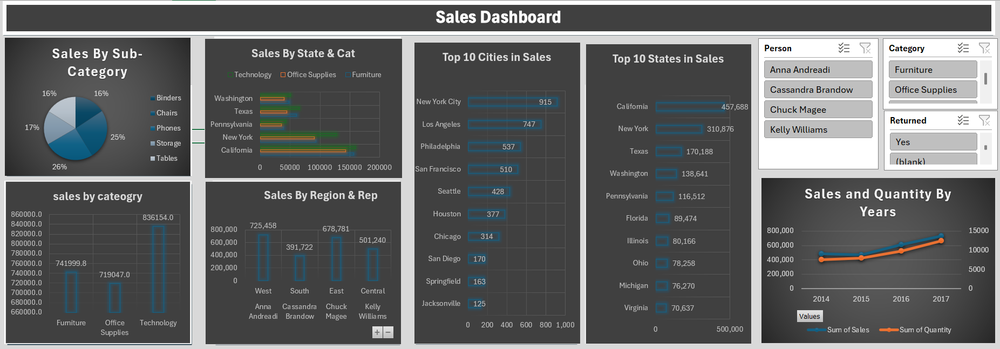

# 📊 Excel Sales Dashboard

An interactive sales dashboard built in Excel to help decision-makers understand sales performance by category, region, state, city, and sales rep.

## 🎯 Project Goal
Turn raw order data (~10,000 orders) into a clear, interactive dashboard that answers business questions quickly.

## 📁 Files
- `Sales_Dashboard.xlsx`: the full workbook (data, pivot tables, and dashboard)
- `dashboard.png`: screenshot of the final dashboard

## 🗂️ Data
The workbook contains these sheets:
- **Orders**: main data (order date, ship mode, customer, city, state, region, category, sub-category, sales, quantity, discount, profit, COGS)
- **Return**: returned orders
- **People**: sales reps and their regions
- **Shipping Cost**: shipping cost per unit by state
- **Power povit / Sales Dashboard Caclulation**: pivot tables behind the charts
- **WireFrame**: the final dashboard

## 🛠️ Tools
Excel · PivotTables · Power Pivot · Slicers · Charts

## 📈 Dashboard Content
- Sales by Category and Sub-Category
- Sales by State and Category
- Top 10 Cities and Top 10 States in Sales
- Sales by Region and Sales Rep
- Sales and Quantity trend by year (2014–2017)
- Interactive slicers: Person, Category, Returned

## 🔍 Key Insights
- California is the top state in sales (~457K)
- Technology is the top-performing category (~836K)
- Sales and quantity grew steadily from 2014 to 2017

## 🚀 How to Use
1. Download `Sales_Dashboard.xlsx`
2. Open it in Excel (Power Pivot features need desktop Excel)
3. Go to the **WireFrame** sheet and use the slicers to filter the dashboard

## 👤 Author
ta7a2004
